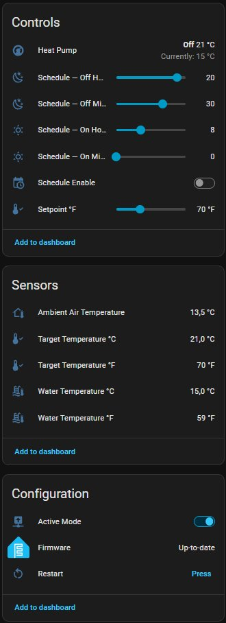
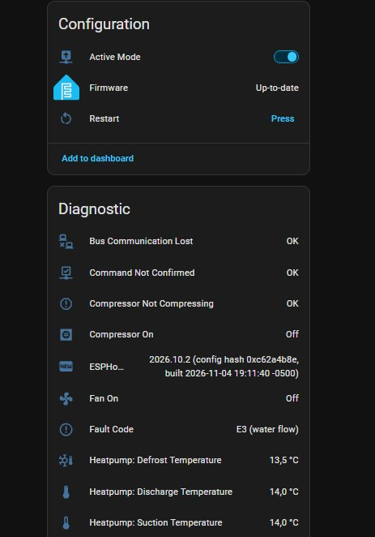

# ESPHome CC207S – Contrôle de thermopompe de piscine (Turcotte TTi, contrôleurs de type Hayward)

*English: [README.md](README.md)*

Contrôle local d'une **thermopompe de piscine équipée du contrôleur CC207S-V2.0**
(Guangdong Chico Electronic) avec [ESPHome](https://esphome.io) et Home
Assistant, sans nuage. L'ESP32 écoute le bus entre la carte et le clavier,
décode la télémétrie et peut changer la consigne et allumer ou éteindre l'unité
comme le fait le clavier.

Rétro-ingénierie faite sur une **Turcotte TTi ECOLO 50**. Seule cette unité a été
testée. Le même contrôleur existe dans d'autres thermopompes (Hayward et autres),
mais rien n'est vérifié pour elles.

> Tu branches un ESP32 sur la ligne de données d'un appareil alimenté en 240 V.
> Lis d'abord [`docs/wiring.md`](docs/wiring.md) (en anglais), mesure par toi-même
> et assume le risque. Voir l'avertissement plus bas.

## Contenu

* `components/cc207s/` : composant ESPHome (C++ et schéma Python).
* `examples/heatpump.yaml` : l'ESP32 de la thermopompe (climate, capteurs,
  horaire ON/OFF qui ne touche jamais à la consigne).
* `docs/CC207S-protocole.md` : protocole, codes de défaut et notes de terrain.
* `docs/wiring.md` : notes d'interface et leçon sur la boucle de masse.

## Captures

Page de l'appareil dans Home Assistant (thermopompe fermée pour l'hiver : le
contrôleur affiche donc `E3 (water flow)`).

## Ce qui est décodé

Consigne, état ON/OFF, températures (eau, air ambiant, aspiration, dégivrage,
refoulement), relais (compresseur, ventilateur, chauffage du carter, pompe) et
les codes E1, E2, E3, E4, P1, P2, P3, P4, P5. **E6 n'est pas décodé** (aucun bit
confirmé) et **P7 n'existe pas sur le bus** : c'est le clavier qui l'affiche.

À savoir :

* Un OFF envoyé sur le bus arrête **seulement le compresseur**. Le ventilateur,
  la pompe de recirculation et le chauffage du carter continuent, comme avec la
  touche OFF du clavier.
* Après une commande, le contrôleur met **4 à 10 s** à la confirmer.
* **P3, P4 et P5 restent verrouillés les nuits de gel**, parfois des heures après
  que l'air est remonté bien au-dessus de 0 °C. Ne déclenche pas d'alerte sur
  chaque changement de `fault_codes` si l'ESP reste alimenté l'hiver.
* On ne sait pas encore si un P5 verrouillé empêche le démarrage
  ([questions ouvertes](docs/CC207S-protocole.md#9-open-questions)).

## Démarrage rapide

1. Câblage : voir `docs/wiring.md` (un fil de données et la masse, niveau
   ramené à 3,3 V, une seule GPIO).
2. Copie `secrets.yaml.example` en `secrets.yaml` et remplis-le.
3. Copie `examples/heatpump.yaml`, règle `pin_txrx` et le fuseau horaire.
4. Premier démarrage avec l'interrupteur **Active Mode éteint** (écoute seule),
   compare les températures avec le clavier, puis active le mode actif.

Les deux fichiers d'exemple passent `esphome config` (ESPHome 2026.10.2). Le
firmware lui-même n'est pas testé automatiquement.

## Autres marques (non vérifié)

Le même contrôleur Guangdong Chico CC207S et le même clavier semblent montés sur
beaucoup de thermopompes de marques différentes (Turcotte, type Hayward, Jacuzzi
vendue par Club Piscine, Fairland en Australie, …). Le clavier est un indice
pour reconnaître la famille, mais **pas une preuve** que le protocole est le même :
seule la TTi ECOLO 50 avec une CC207S-V2.0 a été testée. Détails dans la
[section 11 du protocole](docs/CC207S-protocole.md#11-other-brands-and-models-unverified).
Si vous en possédez une, ouvrez une issue avec une capture du bus, la photo de
l'étiquette de la carte et du clavier.

## Comment ce projet a été fait

L'auteur est technicien en électronique de formation, travaillant comme
technicien de maintenance en câblodistribution, et non programmeur de métier. La méthode est physique et mesurée : débrancher les sondes
une à une, ouvrir les contacts de sécurité, appuyer sur le clavier avec un
chronomètre, enregistrer le bus et comparer avec des sondes de température
indépendantes. Le **code et la documentation ont été produits avec l'aide de
l'IA (Claude, d'Anthropic)**, à partir de ces mesures et du projet amont cité plus
bas. Chaque affirmation de la documentation doit pouvoir se rattacher à une
observation ; ce qui est une hypothèse est indiqué comme telle. Relisez le code
comme n'importe quel projet communautaire, et ne comptez que sur les protections
de la thermopompe, pas sur ce logiciel.

## Crédits et licence

Couche bus, RMT et décodeur de trames reprise de
[sle118/hayward_pool_heater](https://github.com/sle118/hayward_pool_heater)
(MIT, © 2024 S. Leclerc). Le reste (classes de trames CC207S, table d'octets,
logique et documentation) est nouveau. Licence MIT, voir `LICENSE`.

## Avertissement

Fourni tel quel, sans garantie. Les protections du contrôleur (pression, débit,
surintensité) restent inchangées et ne doivent pas être prises pour acquises à
cause de ce projet.
