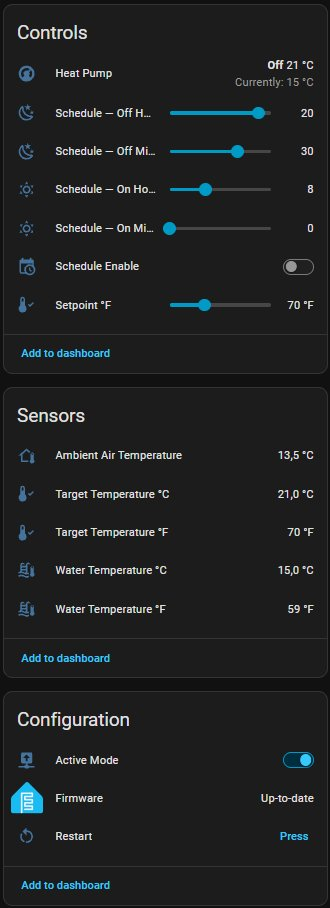
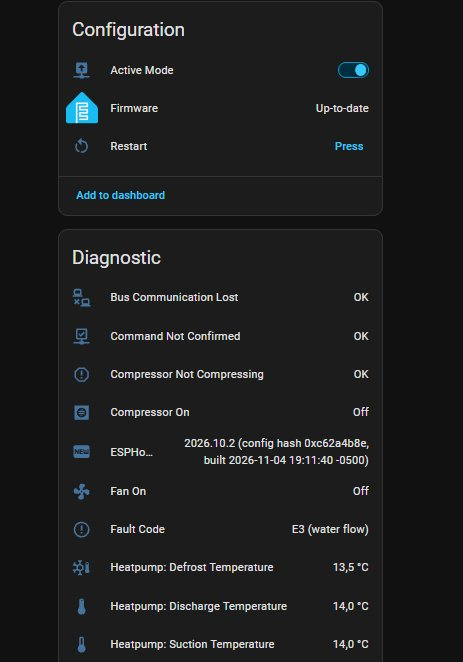

# ESPHome CC207S – Pool heat pump control (Turcotte TTi, Hayward-type controllers)

*Français : [README.fr.md](README.fr.md)*

Local control of a **pool heat pump built around the CC207S-V2.0 controller**
(Guangdong Chico Electronic) from [ESPHome](https://esphome.io) and Home
Assistant — no cloud, no keypad replacement. The ESP32 listens to the bus
between the controller and the wall keypad, decodes the telemetry, and can
change the setpoint and switch the unit on and off the way the keypad does.

It was reverse-engineered on a **Turcotte TTi ECOLO 50** (Quebec). The same board
and keypad protocol are reported in Hayward and other rebadged heat pumps, but
**nothing else has been tested**. Please report what you find
(see [Contributing](#contributing)).

> **Status: works for the author since Aug 2026, but it is hobby-grade
> reverse engineering.** You connect an ESP32 to the data line of a mains-powered
> appliance. Read [`docs/wiring.md`](docs/wiring.md) first, expect to take your
> own measurements, and accept the risk. See the [disclaimer](#disclaimer).

## What you get

| Entity | Notes |
|--------|-------|
| `climate` "Heat Pump" | current water temperature, setpoint (15–33 °C, 0.5 °C steps), OFF / HEAT, heating / idle / off action |
| Ambient air, suction, defrost, discharge temperature | four extra sensors from the telemetry frame |
| `fault_codes` text sensor | `OK` or a list like `E3 (water flow)` or `P3 (defrost sensor)` |
| `compressor_on`, `fan_on` | relay states, handy next to the fault history |
| `compressor_not_compressing` | derived: relay on but discharge−suction stays small (bad start capacitor, seized compressor, lost charge) — the controller has no fault code for it |
| `bus_communication_lost` | no frame for 60 s (broken wire, controller off) |
| `command_not_confirmed` | a command was sent but never echoed back by the controller |
| `unknown_bits_detected` | a bit this decode has never seen |
| `Active Mode` switch | off = passive, listen-only; on = commands are transmitted |

[`examples/heatpump.yaml`](examples/heatpump.yaml) adds Fahrenheit sensors, a
setpoint slider in °F and a minimal daily ON/OFF timer that, like the keypad's
own timer, never touches the setpoint.

## Screenshots

Device page in Home Assistant (heat pump shut down for the winter, so the
controller reports `E3 (water flow)`).




## What is decoded

Setpoint, power state, water / air / suction / defrost / discharge temperatures,
compressor / fan / crankcase heater / pump relays, and the codes E1, E2, E3, E4,
P1, P2, P3, P4, P5. **E6 is not decoded** (no bit confirmed) and **P7 is not on
the bus** — the keypad draws it itself. The full byte map, the test methodology
and an investigation into P3/P4/P5/P7 are in
[`docs/CC207S-protocole.md`](docs/CC207S-protocole.md).

Things you may not expect:

* Switching OFF over the bus stops the **compressor only**. Fan, recirculation
  pump and crankcase heater keep running, exactly like the keypad's OFF key.
* After a command the controller takes **4–10 s** to echo it back.
* **P3/P4/P5 latch on freezing nights** and can stay set for hours at ambient
  temperatures well above 0 °C. Don't alert on every change of `fault_codes` if
  you leave the ESP powered in winter.

## Quick start

1. **Wire it** — [`docs/wiring.md`](docs/wiring.md). Single data wire + ground,
   level-shifted to 3.3 V, one GPIO.
2. Copy [`secrets.yaml.example`](secrets.yaml.example) to `secrets.yaml` and fill it in.
3. Copy [`examples/heatpump.yaml`](examples/heatpump.yaml), set `pin_txrx` and
   your timezone, and make the component available. Either keep the repo layout
   (`path: ../components`) or fetch it from git:

   ```yaml
   external_components:
     - source:
         type: git
         url: https://github.com/fpitre75/esphome-cc207s-pool-heatpump
         ref: main
       components: [cc207s]

   climate:
     - platform: cc207s
       name: "Heat Pump"
       pin_txrx: GPIO27          # the single bus GPIO
       update_interval: 5s
       active_mode_switch:
         name: "Active Mode"
         restore_mode: ALWAYS_OFF   # start passive until you trust the telemetry
       t_ambient:
         name: "Ambient Air Temperature"
       fault_codes:
         name: "Fault Code"
   ```
4. Flash, watch the log (`cc207s: DEBUG`), confirm temperatures match the
   keypad, **then** switch `Active Mode` on.

Requires the ESP-IDF framework on a classic ESP32 (the RMT peripheral is
used). Both example files pass `esphome config` on ESPHome 2026.10.2; the
firmware itself is built and run by the author, there is no CI yet.

## Repository layout

```
components/cc207s/     ESPHome external component (C++ + Python schema)
examples/heatpump.yaml           heat pump ESP32: climate, sensors, timer
docs/CC207S-protocole.md         bus protocol, fault codes, field notes
docs/wiring.md                   interface notes and the ground-loop lesson
secrets.yaml.example
```

Use a dedicated ESP32 for the heat pump: sharing a board and a supply with
other mains-powered equipment caused trouble in the field
([`docs/wiring.md`](docs/wiring.md)).

## Known limitations

* One unit tested. Other CC207S V2.x boards are unverified.
* Heat / cool mode, fan speed and installer parameters are not exposed.
* Whether a latched P5 prevents starting has not been tested
  ([open questions](docs/CC207S-protocole.md#9-open-questions)).
* The decode has only been exercised with the unit idle in freezing weather and
  during the summer heating season; rarely seen faults (E1, E2, E4) were not all
  provoked on purpose.

## Credits

The bus, RMT and frame-decoder layer comes from
[sle118/hayward_pool_heater](https://github.com/sle118/hayward_pool_heater)
(MIT, © 2024 S. Leclerc), which targets Hayward's related protocol. The CC207S
frame classes, byte map, controller logic and documentation are new.
[ericallard3414-arch/Smart-TTI-Ecolo-80](https://github.com/ericallard3414-arch/Smart-TTI-Ecolo-80)
is a related project for the ECOLO-80 with different interface hardware.

## How this was made

The author is an electronics technician by training, working as a cable-TV
maintenance technician, and not a professional programmer. The method was physical and measured: unplug sensors one
at a time, open the safety contacts, press keypad buttons with a stopwatch, log the
bus, and compare against independent temperature probes. The **code and the
write-up were produced with AI assistance (Anthropic's Claude)**, working from
those measurements and from the upstream project above. Every claim in the docs
is meant to be traceable to an observation; where something is a hypothesis it is
labelled as one. Review the code as you would any community project, and
treat the heat-pump protections as authoritative, not this software.

## Contributing

Issues and captures are welcome, especially from other heat pump models. A
useful report includes: the model and controller label, a few minutes of the
`cc207s: DEBUG` log, a keypad photo for any code shown, and the matching
Home Assistant history.

## Disclaimer

Provided as is, without warranty (MIT). Working on heat pump electronics and the
mains supply is dangerous. Nothing here is a safety device: the controller's own
protections (pressure, flow, over-current) are unchanged and must not be relied on
less because of this project. You are responsible for what you connect.

## Licence

MIT — see [`LICENSE`](LICENSE).
