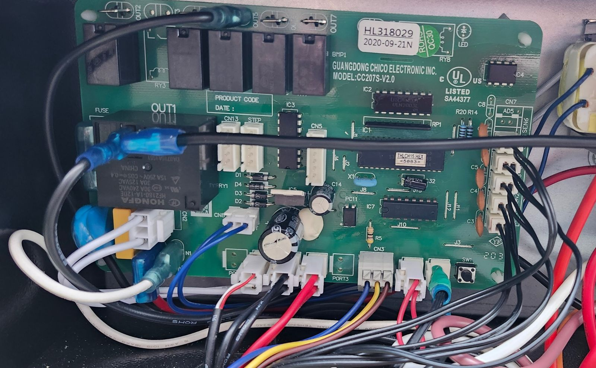
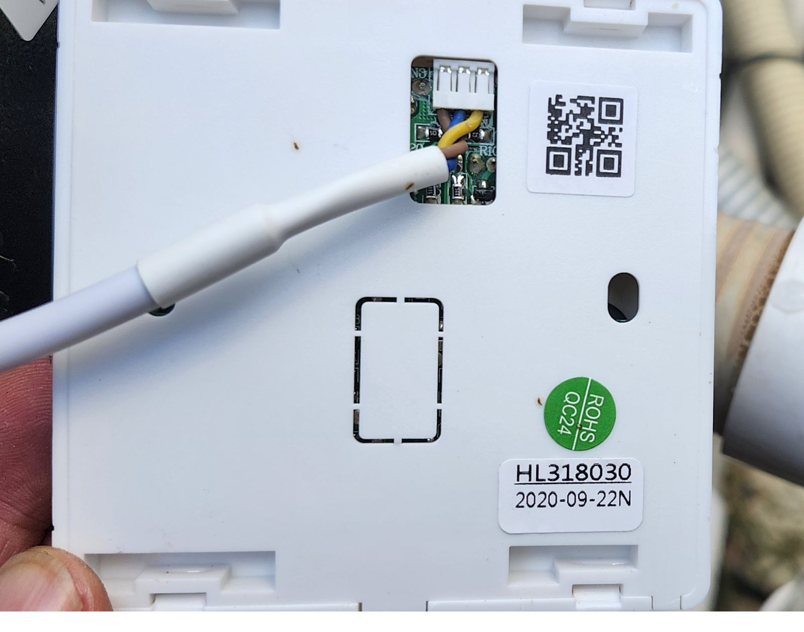
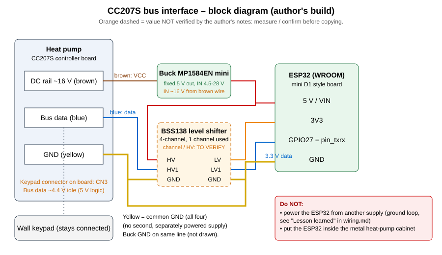

# Wiring the ESP32 to the CC207S bus

> **Mains and heat pump electronics are dangerous.** The CC207S board sits behind
> a 240 V supply on this unit. Work with everything unpowered, never touch the
> board with a grounded instrument while it is powered, and stop if a
> measurement surprises you. This page describes what worked for one installation;
> it is not a certified design.

> **Work in progress:** the photos below show the author's *prototype*, not a
> finished build; final photos will replace them. The shifter channel is still
> marked *to verify* (see the `TODO` marker).

## Where the cable plugs in

On the controller board (label `HL318029`, model `CC207S-V2.0`, firmware label
`THLCH15.HEX <5883>`), the keypad cable lands on the 3-position connector
**CN3**: in the photo, left to right, **blue, yellow, brown**. The keypad end
(`HL318030`) has a 4-pin header with the same three wires. Always confirm with a
multimeter on your own unit.

## What the bus looks like

* The controller, the wall keypad and the ESP32 share **one data wire plus
  ground** (half-duplex, about 500 baud — see
  [`CC207S-protocole.md`](CC207S-protocole.md#1-physical-layer)).
* The ESP32 uses a single GPIO (`pin_txrx`) for receive **and** transmit. The
  component decodes the line with the RMT peripheral, so no UART is involved.
  The GPIO must see clean 3.3 V logic levels, which is what the interface
  below provides.
* **Bus level (author's unit, measured):** the data line is **5 V logic, not
  16 V** — about **4.4 V idle** (pulled up on the controller side), dropping
  during transmission. A standard 3.3 V ↔ 5 V level shifter such as a BSS138
  module is the right part. Measure it on your own unit before choosing an
  interface; do not assume.
* The keypad cable has three wires: blue = data, yellow = ground, brown = about
  16 V DC. **Never connect the brown wire to an ESP32 pin or 3.3 V/5 V rail
  directly.**
* To listen only, tap **blue + yellow in parallel** — nothing has to be cut.
* Transmit with an **open-drain** output, never push-pull.

## Interface that worked (author's build)

*Cable colours on the author's unit: **blue** = data (single bidirectional open-drain line), **yellow** = ground, **brown** = VCC (about 16 V DC). Block diagram: heat-pump rail → MP1584EN mini buck (fixed 5 V) → ESP32 (5 V); BSS138 shifter between the
bus data wire and GPIO27; one common ground. Orange items are unverified.*

* Classic **ESP32 (WROOM)**, not an ESP32-C3: the original validated design used
  one and the author avoided introducing an untested chip family while chasing a
  ground problem (below). The RMT driver is used through ESP-IDF.
* A **BSS138 bidirectional 4-channel level shifter** between the bus and
  the GPIO (high side = bus voltage, low side = 3.3 V), data on one channel.
  `TODO(maintainer)`: add which channel/pins and a photo.
* The ESP32 board was powered from the **heat pump's own low-voltage DC rail
  through a small fixed-5 V buck module (MP1584EN, 3 A class, input about 4.5–28 V per the chip datasheet; check that the rail stays within that range)** in the first, keypad-emulation build, so that its
  ground is the controller's ground by construction.
* Short wires. A 5 m quad-wire test run worked fine, so cable length was not the
  problem in the field.
* Put the ESP32 in its **own small non-metallic enclosure outside the heat pump
  cabinet** (antenna, chassis bonding).

### Prior art with different interface hardware

[ericallard3414-arch/Smart-TTI-Ecolo-80](https://github.com/ericallard3414-arch/Smart-TTI-Ecolo-80)
(an ECOLO-80, same Turcotte TTi family) uses two GPIOs on the same shared wire:
a 10 kΩ / 22 kΩ voltage divider for receive and a 2N3904 NPN open-collector
transistor for transmit, powered from the heat pump's own 16–18 V rail through a
buck converter. Its cable colours are the same as the author's (brown ≈ 16 V DC, yellow = ground,
blue = data); still confirm on your own unit with a multimeter before connecting.
That project's schematic is not reproduced here.

## Lesson learned: do not bridge two separately powered systems

The author first moved the heat pump onto an existing 4-relay ESP32 board (an
ESP32-Relay-X4, `pin_txrx` on GPIO16) that was already running the pool lights
and fountain from a DIN-rail 120 V → 12 V supply. The result:

* the physical keypad display froze fully lit;
* power-cycling the heat pump then showed an **unmapped `E8`** code (never
  decoded by this component);
* the bus stayed "disconnected" after reconnecting the ESP.

Findings during that debugging session:

* About **25 VAC** was measured between the neutral of the relay board and the
  neutral of the CC207S board, and between the board neutral and the data line —
  consistent with a missing or wrong common reference between two supplies that
  have nothing to do with each other.
* The CC207S board is fed by its own internal transformer and diode bridge from
  the heat pump's **240 V (L1-L2)**; the relay board came from a **120 V**
  circuit, and the two were on **separate GFCI breakers**.
* Tying the DC grounds together and trying the data line on either side of the
  level shifter made no difference: the two references still did not match.
* GPIO16 itself was ruled out (no PSRAM, no special reservation on that board).

The practical outcome was to go back to a **dedicated ESP32 for the heat pump**
and keep the relay board for lights, fountain and probes only. The
exact root cause was not confirmed with an instrument beyond the measurements
above, so treat "ground loop between separately powered supplies" as the most
likely explanation, not a proven one.

If something looks wrong after connecting (keypad frozen, odd `E` codes), unplug
the ESP first — in the author's case that restored the keypad.

## Checks before powering up

1. Heat pump fully de-energised; keypad connector identified.
2. Continuity from the interface ground to the controller ground.
3. Bus voltage measured with the keypad connected.
4. Interface outputs verified on the bench (no bus connected) with a 3.3 V
   logic level on the ESP32 side.
5. First boot in **passive mode** (`Active Mode` switch off): the component only
   listens, and `bus_communication_lost` should stay off within a minute. Turn
   active mode on only once telemetry looks sane.
